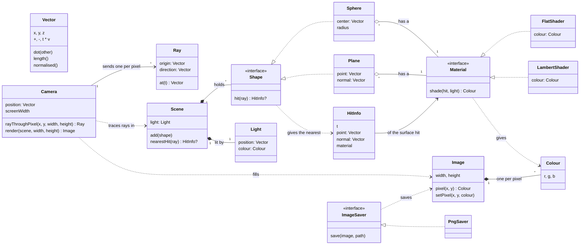

# Domain model

How the ray tracer sees the client's problem, at the end of week 1 (m1).

The camera sends one ray through each pixel of the image. The scene finds the nearest surface the ray hits. That surface's material, lit by the scene's light, gives the pixel its colour. A saver writes the image to a file.

## Words we use

| Word | Meaning in the code |
|---|---|
| Ray | A half line from an origin, in a direction: the point at t is `origin + t * direction` |
| Hit | Where a ray meets a surface: `t`, the point, the unit normal there, and the surface's material |
| Normal | The unit vector perpendicular to the surface at the hit point, pointing outwards |
| Material | How a surface turns light into a colour (flat, or Lambert's law) |
| Screen | A rectangle 1 in front of the camera, `screenWidth` wide, cut into the image's pixels |
| Coordinates | x to the right, y up, z forward; pixels counted from the top left corner |

## Who does what

- `trace(ray, scene)` colours one pixel: the nearest hit's material shades it with the scene's light, or the pixel is black.
- A shape **has a** material; it is not a kind of material. The same material can be shared by several shapes.
- The scene owns its shapes. A hit only points to the material, which lives as long as its shape.
